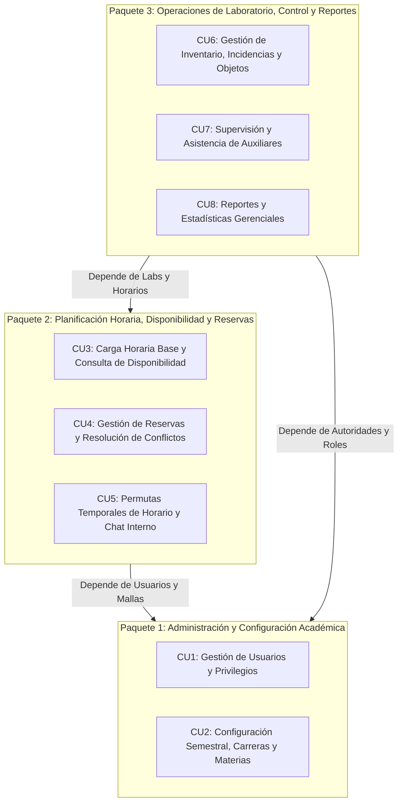
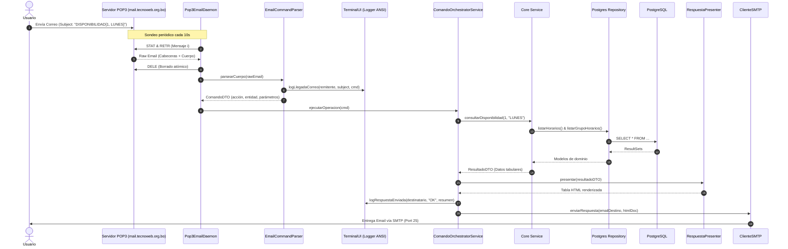
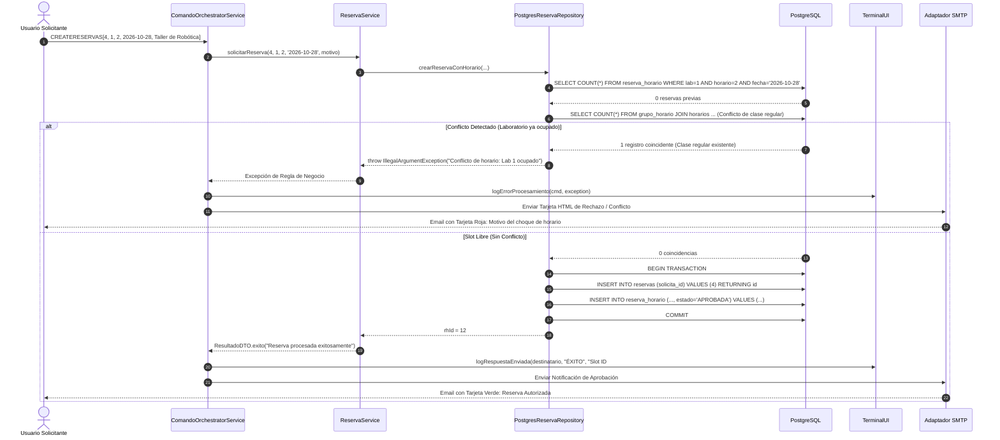
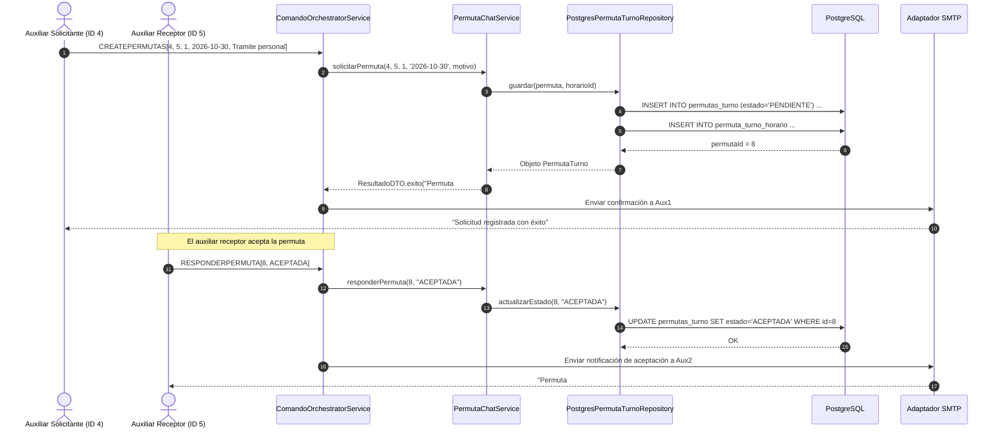
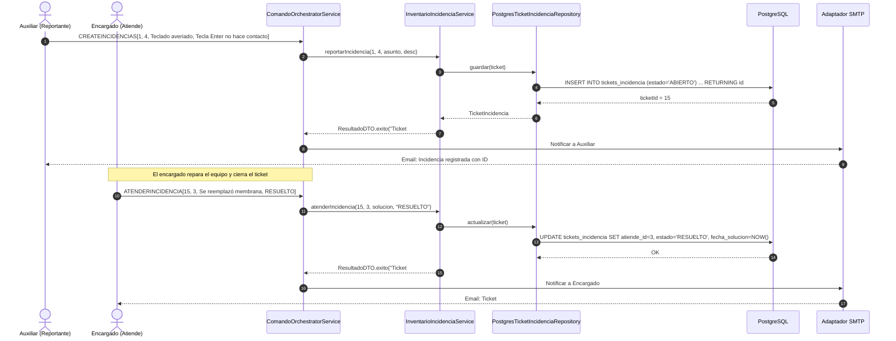

# DOCUMENTACIÓN TÉCNICA Y ESPECIFICACIÓN DEL SISTEMA (METODOLOGÍA PUD)
## GESTIÓN INTEGRAL DE LABORATORIOS DE FACULTAD MEDIANTE COMANDOS DE CORREO (POP3/SMTP)

---

### 1. INTRODUCCIÓN Y ALCANCE
El presente documento describe la arquitectura, captura de requisitos, especificación formal de casos de uso y diseño de base de datos (conceptual, lógico y físico) del **Sistema de Gestión de Laboratorios de la Facultad**, implementado bajo arquitectura hexagonal (Puertos y Adaptadores) en Java puro, comunicándose de forma asíncrona mediante protocolos de correo electrónico (POP3 para ingesta de comandos y SMTP para notificación de resultados).

---

### 2. CAPTURA DE REQUISITOS

#### 2.1 Requisitos Funcionales (RF)
- **RF-01 (Gestión de Usuarios y Roles):** El sistema debe permitir el alta, baja, modificación, consulta y autenticación de usuarios categorizados por roles: Decano, Director de Carrera, Encargado de Laboratorio y Auxiliar de Laboratorio.
- **RF-02 (Gestión de Privilegios):** El sistema debe soportar la asignación granular y revocación de privilegios de acceso a las operaciones.
- **RF-03 (Configuración Semestral y Académica):** El sistema debe permitir registrar periodos de gestión académica (ej. 2026-2), carreras, materias y su vinculación curricular por semestre académico.
- **RF-04 (Administración de Carga Horaria Base):** El sistema debe gestionar aulas/laboratorios físicos, franjas horarias y la asignación fija de grupos académicos a laboratorios.
- **RF-05 (Consulta de Disponibilidad de Laboratorios):** El sistema debe calcular en tiempo real los bloques libres y ocupados de cualquier laboratorio para un día específico o semana completa.
- **RF-06 (Gestión de Reservas y Resolución de Conflictos):** El sistema debe permitir la reserva extraordinaria de laboratorios, verificando de forma estricta la ausencia de solapamiento horario contra clases regulares y otras reservas activas.
- **RF-07 (Gestión de Permutas Temporales de Turno):** Los auxiliares deben poder solicitar y responder (aceptar/rechazar) permutas de sus turnos de laboratorio ante ausencias programadas.
- **RF-08 (Chat y Mensajería Interna):** Los usuarios del sistema deben poder intercambiar mensajes internos con registro cronológico y control de lectura.
- **RF-09 (Control de Inventario de Laboratorios):** Registro de activos computacionales y equipamiento de laboratorio, con código patrimonial y estado físico (Bueno, Regular, Malo, etc.).
- **RF-10 (Gestión de Incidencias Técnicas):** Registro de fallas técnicas en activos de inventario, con asignación a encargados y seguimiento de soluciones aplicadas.
- **RF-11 (Registro y Entrega de Objetos Perdidos):** Control de pertenencias encontradas en laboratorios, registro de entrega y reclamo por propietarios.
- **RF-12 (Supervisión de Asistencia de Auxiliares):** Registro y control de asistencia a turnos asignados (Presente, Falta, Licencia, Retraso).
- **RF-13 (Reportes Estadísticos y Gerenciales):** Generación consolidada de métricas de cumplimiento de auxiliares, ocupación de laboratorios, estadísticas de incidentes y estado del inventario.

#### 2.2 Requisitos No Funcionales (RNF)
- **RNF-01 (Arquitectura Hexagonal):** Desacoplamiento total del núcleo de negocio respecto a los adaptadores de persistencia (PostgreSQL) y transporte (POP3/SMTP).
- **RNF-02 (Canal de Comunicación Vía Correo):** Interfaz desacoplada basada en comandos enviados en el encabezado `Subject` del correo electrónico.
- **RNF-03 (Trazabilidad y Logging Detallado):** Paneles estructurados en consola terminal (ANSI) que diferencian con precisión:
  - Llegada y parseo de peticiones.
  - Errores de procesamiento con contexto de causa raíz.
  - Respuestas despachadas por SMTP.
- **RNF-04 (Seguridad de Contraseñas):** Las credenciales de acceso se almacenan hasheadas mediante algoritmo BCrypt (`jBCrypt`).
- **RNF-05 (Concurrencia e Integridad Transaccional):** Control estricto de transacciones SQL (`ACID`) para evitar reservas concurrentes sobre el mismo slot horario.

---

### 3. ACTORES DEL SISTEMA

| Actor | Descripción y Responsabilidad Principal |
| :--- | :--- |
| **Decano** | Máxima autoridad facultativa. Supervisa reportes gerenciales consolidados de ocupación, inventario y rendimiento de personal auxiliar. |
| **Director de Carrera** | Gestiona periodos semestrales, carreras, asignaciones curriculares y supervisa la asistencia global de auxiliares. |
| **Encargado de Laboratorio** | Administra los laboratorios físicos, atiende tickets de incidencias técnicas en equipos y custodia objetos perdidos. |
| **Auxiliar de Laboratorio** | Registra asistencia a sus turnos asignados, reporta incidencias de equipamiento, solicita reservas y gestiona permutas de horario. |
| **Docente / Usuario Académico** | Consulta disponibilidad de laboratorios y solicita reservas extraordinarias para clases prácticas o talleres. |
| **Daemon POP3 (Actor del Sistema)** | Proceso en segundo plano que sondea la casilla de correo cada 10 segundos, extrae los comandos y desencadena la ejecución. |

---

### 4. DIVISIÓN EN PAQUETES DE CASOS DE USO (CONSOLIDADO EN 3 SUBSISTEMAS)

Para reducir la sobrefragmentación y maximizar la cohesión funcional del sistema, los 8 casos de uso aprobados se estructuran en **3 paquetes arquitectónicos**:

1. **Paquete 1: Administración y Configuración Académica (Core & Security)**: Centraliza la gestión de usuarios, roles, privilegios, periodos semestrales, carreras y mallas curriculares de materias.
2. **Paquete 2: Planificación Horaria, Disponibilidad y Reservas (Scheduling & Spaces)**: Administra las aulas/laboratorios físicos, franjas horarias, carga regular, consulta dinámica de disponibilidad, reservas con motor de detección de conflictos y coordinación de permutas y mensajería interna.
3. **Paquete 3: Operaciones de Laboratorio, Control y Reportes (Operations & Analytics)**: Gobierna el inventario de equipamiento, tickets de incidencias técnicas, objetos encontrados/perdidos, control de asistencia de auxiliares y generación de métricas y estadísticas consolidadas.



---

### 5. ESPECIFICACIÓN DETALLADA DE CASOS DE USO (TABLAS FORMATO PUD)

#### CU1: Gestión de Usuarios y Privilegios
| Campo | Especificación Formal |
| :--- | :--- |
| **Identificador y Nombre** | **CU1: Gestión de Usuarios y Privilegios** |
| **Paquete** | Paquete 1: Administración y Configuración Académica |
| **Actores** | Decano, Director de Carrera, Encargado de Laboratorio |
| **Propósito** | Administrar el ciclo de vida (CRUD) de usuarios de la facultad y asignar privilegios específicos de operación. |
| **Precondiciones** | Base de datos activa; el emisor del correo debe contar con privilegios administrativos o rol autorizado. |
| **Comando / Sintaxis** | `CREATEUSUARIOS[nombres, apellidoP, apellidoM, genero, ci, fechaNac, telefono, rol, email, password, regInst]`<br>`LISTARUSUARIOS[*]` \| `GETUSUARIOS[id]` \| `UPDATEUSUARIOS[...]` \| `DELETEUSUARIOS[id]`<br>`ASIGNARPRIVILEGIO[usuarioId, privilegioId]` \| `LISTARPRIVILEGIOS[*]` |
| **Flujo Principal** | 1. El usuario envía un correo electrónico con el comando y sus parámetros en el asunto (`Subject`).<br>2. El Daemon POP3 recupera el mensaje y `EmailCommandParser` clasifica la acción `CREATE` y entidad `USUARIOS`.<br>3. `TerminalUI` emite un panel en consola con los datos del remitente y los parámetros recibidos.<br>4. `UsuarioService` valida los datos obligatorios y aplica hashing BCrypt a la contraseña.<br>5. `PostgresUsuarioRepository` ejecuta la inserción en la tabla `usuarios` y retorna el ID autogenerado.<br>6. `RespuestaPresenter` formatea el resultado en tarjeta HTML verde de éxito.<br>7. `TerminalUI` registra en consola la respuesta saliente y el adaptador SMTP despacha el correo de confirmación. |
| **Flujos Alternativos** | **3a. Parámetros incompletos:** Si faltan campos obligatorios, el sistema retorna `ResultadoDTO.parametroInvalido` indicando la sintaxis requerida.<br>**5a. Violación de Unicidad:** Si el CI o email ya existen, la BD lanza excepción; `ErrorCentralizador` la traduce a mensaje amigable sin interrumpir el daemon.<br>**7a. Falla de Envío SMTP:** Se registra en consola el error de transporte y se mantiene la persistencia intacta. |
| **Postcondiciones** | El usuario queda registrado con credenciales cifradas y disponible para autenticación y asignación de turnos. |

#### CU2: Configuración Semestral, Carreras y Materias
| Campo | Especificación Formal |
| :--- | :--- |
| **Identificador y Nombre** | **CU2: Configuración Semestral, Carreras y Materias** |
| **Paquete** | Paquete 1: Administración y Configuración Académica |
| **Actores** | Director de Carrera, Decano |
| **Propósito** | Configurar los periodos semestrales, el catálogo de carreras, materias y su vinculación curricular por semestre. |
| **Precondiciones** | Usuarios registrados previamente en el sistema. |
| **Comando / Sintaxis** | `CREATEPERIODOS[gestion, semestre]` \| `LISTARPERIODOS[*]`<br>`CREATECARRERAS[codigo, nombre, sigla]` \| `LISTARCARRERAS[*]`<br>`CREATEMATERIAS[nombre, sigla]` \| `LISTARMATERIAS[*]`<br>`ASIGNARCARRERA[usuarioId, carreraId]` \| `CARRERAMATERIA[carreraId, materiaId, nivelSemestre]` |
| **Flujo Principal** | 1. El actor envía el comando correspondiente a la configuración deseada en el asunto del email.<br>2. El parser extrae la entidad objetivo (`PERIODOS`, `CARRERAS`, `MATERIAS`, etc.).<br>3. `ConfiguracionSemestralService` procesa la entidad y delega al repositorio PostgreSQL respectivo.<br>4. Se registra la relación (ej. `carrera_materia` con nivel semestral).<br>5. Se emite confirmación por SMTP con el detalle del registro generado. |
| **Flujos Alternativos** | **3a. Duplicado:** Si el periodo (`gestion, semestre`) o la sigla de carrera/materia ya existen, el sistema rechaza la operación informando la duplicidad.<br>**3b. Referencia Inválida:** Si se intenta vincular una carrera o materia inexistente, se notifica error de clave foránea. |
| **Postcondiciones** | La estructura curricular queda lista para la apertura de grupos y asignación de carga horaria. |

#### CU3: Carga Horaria Base y Consulta de Disponibilidad
| Campo | Especificación Formal |
| :--- | :--- |
| **Identificador y Nombre** | **CU3: Carga Horaria Base y Consulta de Disponibilidad** |
| **Paquete** | Paquete 2: Planificación Horaria, Disponibilidad y Reservas |
| **Actores** | Director de Carrera, Encargado, Auxiliares, Docentes |
| **Propósito** | Registrar laboratorios físicos, horarios regulares de clases y permitir consultar los horarios libres/ocupados de cualquier laboratorio. |
| **Precondiciones** | Carreras, materias y periodos configurados previamente. |
| **Comando / Sintaxis** | `CREATELABORATORIOS[nombre, aula]` \| `LISTARLABORATORIOS[*]`<br>`CREATEHORARIOS[dia, horaInicio, horaFin]` \| `LISTARHORARIOS[*]`<br>`CREATEGRUPOS[nombre, materiaId, usuarioId, periodoId]` \| `LISTARGRUPOS[*]`<br>`ASIGNARHORARIO[grupoId, horarioId, laboratorioId]`<br>`DISPONIBILIDAD[laboratorioId, dia]` o `DISPONIBILIDAD[laboratorioId, *]` |
| **Flujo Principal** | 1. El actor consulta la disponibilidad enviando: `DISPONIBILIDAD[1, LUNES]`.<br>2. `CargaHorariaService` obtiene la lista completa de franjas horarias configuradas.<br>3. Recupera las asignaciones regulares activas (`grupo_horario`) y cruza los slots con el laboratorio especificado.<br>4. Evalúa si el horario está ocupado por clase de grupo o disponible.<br>5. Retorna una tabla HTML con columnas: Laboratorio, Aula, Día, Horario, Disponibilidad (LIBRE/OCUPADO) y Detalle del Grupo.<br>6. El servidor SMTP despacha la tabla de disponibilidad al remitente. |
| **Flujos Alternativos** | **2a. Laboratorio no encontrado:** Si el ID de laboratorio no existe, se responde con tarjeta de "Registro no encontrado".<br>**2b. Día no válido:** Si el día no coincide, el sistema lista todos los días de la semana de ese laboratorio. |
| **Postcondiciones** | Los usuarios visualizan con certeza qué horarios están desocupados para planificar reservas. |

#### CU4: Gestión de Reservas, Notificaciones y Resolución de Conflictos
| Campo | Especificación Formal |
| :--- | :--- |
| **Identificador y Nombre** | **CU4: Gestión de Reservas, Notificaciones y Resolución de Conflictos** |
| **Paquete** | Paquete 2: Planificación Horaria, Disponibilidad y Reservas |
| **Actores** | Docentes, Auxiliares, Encargados |
| **Propósito** | Registrar reservas extraordinarias de laboratorios resolviendo cualquier choque de horario en forma preventiva y automática. |
| **Precondiciones** | El usuario solicitante y el laboratorio deben existir en la base de datos. |
| **Comando / Sintaxis** | `CREATERESERVAS[usuarioId, laboratorioId, horarioId, fechaUso, motivo]`<br>`LISTARRESERVAS[*]`<br>`ESTADORESERVA[reservaHorarioId, estado]` (APROBADA, RECHAZADA, CANCELADA) |
| **Flujo Principal** | 1. El solicitante envía: `CREATERESERVAS[4, 1, 2, 2026-10-28, Practica Especial]`.<br>2. `ReservaService` invoca `verificarConflicto(labId, horarioId, fechaUso)` en `PostgresReservaRepository`.<br>3. El repositorio ejecuta 2 comprobaciones estrictas:<br>   a. Verifica si existe otra reserva en ese laboratorio, fecha y horario con estado distinto a `RECHAZADA` o `CANCELADA`.<br>   b. Determina el día de la semana de la fecha solicitada y valida si hay una clase regular fija en `grupo_horario`.<br>4. Si **no hay conflicto**, abre transacción SQL, crea la reserva padre, inserta el slot en `reserva_horario` con estado `APROBADA` y hace commit.<br>5. Emite confirmación al solicitante con el ID del slot y la fecha autorizada. |
| **Flujos Alternativos** | **3a. Conflicto Detectado (Laboratorio Ocupado):** Si el slot está comprometido, se cancela la transacción, se genera una excepción `IllegalArgumentException("Conflicto de horario: El laboratorio ya se encuentra ocupado...")`, `TerminalUI` muestra el panel rojo de error en terminal y se despacha un email de rechazo fundamentado.<br>**4a. Fecha inválida:** Si la fecha tiene formato incorrecto, se rechaza la solicitud. |
| **Postcondiciones** | Se garantiza la exclusión mutua de uso del laboratorio: ninguna reserva se solapa con clases u otras reservas. |

#### CU5: Gestión de Permutas Temporales de Horario y Chat Interno
| Campo | Especificación Formal |
| :--- | :--- |
| **Identificador y Nombre** | **CU5: Gestión de Permutas Temporales de Horario y Chat Interno** |
| **Paquete** | Paquete 2: Planificación Horaria, Disponibilidad y Reservas |
| **Actores** | Auxiliares de Laboratorio |
| **Propósito** | Facilitar el intercambio de turnos entre auxiliares ante emergencias o ausencias programadas y permitir mensajería interna. |
| **Precondiciones** | Ambos auxiliares deben estar registrados como usuarios activos. |
| **Comando / Sintaxis** | `CREATEPERMUTAS[solicitanteId, receptorId, horarioId, fechaAusencia, motivo]`<br>`RESPONDERPERMUTA[permutaId, ACEPTADA/RECHAZADA]`<br>`LISTARPERMUTAS[*]` \| `LISTARPERMUTAS[usuarioId]`<br>`CHAT[remitenteId, destinatarioId, contenidoMensaje]` \| `LISTARCHAT[usuario1, usuario2]` |
| **Flujo Principal (Permuta)** | 1. El auxiliar A envía solicitud de permuta indicando al auxiliar B, horario y fecha de ausencia.<br>2. El sistema valida que solicitante $\neq$ receptor y registra la permuta con estado `PENDIENTE`.<br>3. El auxiliar B revisa sus permutas (`LISTARPERMUTAS[5]`) y envía: `RESPONDERPERMUTA[1, ACEPTADA]`.<br>4. El estado se actualiza en base de datos y se remite confirmación a ambas partes. |
| **Flujo Principal (Chat)** | 1. El usuario envía `CHAT[4, 5, Mensaje...]`.<br>2. Se persiste en la tabla `chats` con timestamp del servidor y estado no leído.<br>3. Al consultar `LISTARCHAT[4, 5]`, el sistema devuelve la conversación cronológica formateada en tabla. |
| **Flujos Alternativos** | **1a. Auto-permuta:** Si el solicitante ingresa su propio ID como receptor, se rechaza inmediatamente.<br>**2a. Permuta no encontrada:** Si el ID de permuta no existe al responder, se envía tarjeta de error. |
| **Postcondiciones** | Queda registro histórico de los cambios de turno para fines de control de asistencia. |

#### CU6: Gestión de Inventario, Incidencias y Objetos Encontrados
| Campo | Especificación Formal |
| :--- | :--- |
| **Identificador y Nombre** | **CU6: Gestión de Inventario, Incidencias y Objetos Encontrados** |
| **Paquete** | Paquete 3: Operaciones de Laboratorio, Control y Reportes |
| **Actores** | Encargado de Laboratorio, Auxiliares |
| **Propósito** | Controlar los activos físicos de cada laboratorio, registrar y atender reportes de fallas técnicas, y registrar objetos olvidados y entregados. |
| **Precondiciones** | Laboratorios registrados previamente. |
| **Comando / Sintaxis** | `CREATEITEMS[labId, codigo, nombre, descripcion, estadoFisico]` \| `LISTARITEMS[*]`<br>`CREATEINCIDENCIAS[itemId, reportaId, asunto, descripcion]` \| `LISTARINCIDENCIAS[*]`<br>`ATENDERINCIDENCIA[ticketId, atiendeId, solucion, RESUELTO]`<br>`CREATEOBJETOS[labId, registraId, descripcion]` \| `ENTREGAROBJETO[objetoId, reclamaId]` \| `LISTAROBJETOS[*]` |
| **Flujo Principal (Incidencias)**| 1. El auxiliar detecta una falla en un equipo y envía: `CREATEINCIDENCIAS[1, 4, Falla Monitor, No enciende pantalla]`.<br>2. El sistema crea el ticket en estado `ABIERTO` con fecha actual.<br>3. El encargado repara el equipo y envía: `ATENDERINCIDENCIA[1, 3, Se cambio cable de poder, RESUELTO]`.<br>4. Se actualiza el ticket con la solución, fecha de resolución y estado `RESUELTO`. |
| **Flujo Principal (Objetos)** | 1. El auxiliar encuentra un objeto y lo registra con `CREATEOBJETOS[...]` en estado `REPORTADO`.<br>2. Cuando el dueño se presenta, el encargado ejecuta `ENTREGAROBJETO[objetoId, reclamaId]`.<br>3. El objeto pasa a estado `ENTREGADO` con fecha de entrega. |
| **Flujos Alternativos** | **1a. Código de ítem duplicado:** Si se intenta registrar un ítem con código patrimonial existente, la BD rechaza el registro.<br>**3a. Ticket inexistente:** Se notifica que el ticket a resolver no existe. |
| **Postcondiciones** | Trazabilidad del estado del equipamiento físico y custodia de pertenencias de estudiantes. |

#### CU7: Gestión de Supervisión Asistencia de Auxiliares
| Campo | Especificación Formal |
| :--- | :--- |
| **Identificador y Nombre** | **CU7: Gestión de Supervisión Asistencia de Auxiliares** |
| **Paquete** | Paquete 3: Operaciones de Laboratorio, Control y Reportes |
| **Actores** | Director de Carrera, Encargado, Auxiliares |
| **Propósito** | Supervisar y registrar el cumplimiento de asistencia de los auxiliares a sus turnos de laboratorio asignados. |
| **Precondiciones** | Auxiliares y grupos creados en el sistema. |
| **Comando / Sintaxis** | `CREATEASISTENCIAS[auxiliarId, grupoId, fecha, estado]` (Estados: `PRESENTE`, `FALTA`, `LICENCIA`, `RETRASO`)<br>`LISTARASISTENCIAS[*]` \| `LISTARASISTENCIAS[auxiliarId]` |
| **Flujo Principal** | 1. El actor registra la asistencia: `CREATEASISTENCIAS[4, 1, 2026-10-14, PRESENTE]`.<br>2. `AsistenciaService` valida el estado y persiste en `asistencias`.<br>3. El sistema retorna confirmación con el ID generado.<br>4. Las autoridades pueden auditar el historial enviando `LISTARASISTENCIAS[*]`. |
| **Flujos Alternativos** | **1a. Auxiliar inexistente:** Si el ID de usuario no existe, la restricción de integridad foránea detiene la inserción y se emite error explicativo.<br>**1b. Estado no estándar:** Si el estado viene vacío, se asigna `PRESENTE` por defecto. |
| **Postcondiciones** | La base de datos almacena los registros que alimentarán los reportes de cumplimiento mensual de los auxiliares. |

#### CU8: Reportes y Estadísticas Gerenciales
| Campo | Especificación Formal |
| :--- | :--- |
| **Identificador y Nombre** | **CU8: Reportes y Estadísticas Gerenciales** |
| **Paquete** | Paquete 3: Operaciones de Laboratorio, Control y Reportes |
| **Actores** | Decano, Director de Carrera, Encargado |
| **Propósito** | Proporcionar a las autoridades facultativas métricas consolidadas sobre el uso de recursos, rendimiento de auxiliares y estado del equipamiento. |
| **Precondiciones** | Debe existir actividad y registros acumulados en el semestre activo. |
| **Comando / Sintaxis** | `REPORTEASISTENCIA[*]`<br>`REPORTEOCUPACION[*]`<br>`REPORTEINCIDENCIAS[*]`<br>`REPORTEINVENTARIO[*]`<br>`REPORTEOBJETOS[*]` |
| **Flujo Principal** | 1. El Decano o Director envía el comando de reporte deseado (ej. `REPORTEASISTENCIA[*]`).<br>2. `ReporteService` ejecuta consultas SQL agregadas (`SUM`, `COUNT`, `ROUND`, `GROUP BY`) optimizadas para reportes analíticos.<br>3. Para asistencia calcula: Total de turnos, Presentes, Faltas, Licencias y el `% de Cumplimiento` individual.<br>4. `RespuestaPresenter` estructura los resultados en una tabla HTML con estilos ejecutivos y cabecera azul institucional.<br>5. El adaptador SMTP despacha el informe al correo de la autoridad solicitante. |
| **Flujos Alternativos** | **2a. Sin datos:** Si no hay registros que coincidan, se responde indicando que no se registran datos en el periodo. |
| **Postcondiciones** | Las autoridades reciben información cuantitativa oportuna para la toma de decisiones y liquidación de horas auxiliares. |

---

### 6. DISEÑO DE LA BASE DE DATOS

#### 6.1 Diseño Conceptual (Diagrama Entidad-Relación)

```mermaid
erDiagram
    USUARIO ||--o{ USUARIO_PRIVILEGIO : posee
    PRIVILEGIO ||--o{ USUARIO_PRIVILEGIO : asignado_en

    USUARIO ||--o{ USUARIO_CARRERA : inscrito_en
    CARRERA ||--o{ USUARIO_CARRERA : contiene

    CARRERA ||--o{ CARRERA_MATERIA : incluye
    MATERIA ||--o{ CARRERA_MATERIA : asignada_en

    MATERIA ||--o{ GRUPO : pertenece
    USUARIO ||--o{ GRUPO : dicta
    PERIODO ||--o{ GRUPO : corresponde

    GRUPO ||--o{ GRUPO_HORARIO : programado_en
    HORARIO ||--o{ GRUPO_HORARIO : define_tiempo
    LABORATORIO ||--o{ GRUPO_HORARIO : alberga

    USUARIO ||--o{ USUARIO_HORARIO : turno_asignado
    HORARIO ||--o{ USUARIO_HORARIO : especifica_slot

    USUARIO ||--o{ ASISTENCIA : registra_asistencia
    GRUPO ||--o{ ASISTENCIA : evaluada_en

    USUARIO ||--o{ PERMUTA_TURNO : solicita
    USUARIO ||--o{ PERMUTA_TURNO : recibe_solicitud
    PERMUTA_TURNO ||--o{ PERMUTA_TURNO_HORARIO : afecta_a
    HORARIO ||--o{ PERMUTA_TURNO_HORARIO : horario_permutado

    USUARIO ||--o{ CHAT : envia
    USUARIO ||--o{ CHAT : recibe

    LABORATORIO ||--o{ ITEM_INVENTARIO : contiene
    ITEM_INVENTARIO ||--o{ TICKET_INCIDENCIA : genera_falla
    USUARIO ||--o{ TICKET_INCIDENCIA : reporta
    USUARIO ||--o{ TICKET_INCIDENCIA : atiende

    LABORATORIO ||--o{ OBJETO_PERDIDO : encontrado_en
    USUARIO ||--o{ OBJETO_PERDIDO : encuentra_y_registra
    USUARIO ||--o{ OBJETO_PERDIDO : reclama_y_recibe

    USUARIO ||--o{ RESERVA : solicita_reserva
    RESERVA ||--o{ RESERVA_HORARIO : desglosada_en
    HORARIO ||--o{ RESERVA_HORARIO : horario_reservado
    LABORATORIO ||--o{ RESERVA_HORARIO : laboratorio_reservado
```



#### 6.2 Diseño Lógico (Esquema Relacional Normalizado en 3FN)

- **USUARIOS** (<u>id</u>, nombres, apellido_p, apellido_m, genero, foto, ci [UK], fecha_nacimiento, telefono, rol, email [UK], password_hash, registro_institucional, estado)
- **PRIVILEGIOS** (<u>id</u>, codigo [UK], nombre, descripcion)
- **USUARIO_PRIVILEGIO** (<u>usuario_id</u> [FK], <u>privilegio_id</u> [FK], fecha_asignacion, estado)
- **CARRERAS** (<u>id</u>, codigo [UK], nombre, sigla)
- **USUARIO_CARRERA** (<u>usuario_id</u> [FK], <u>carrera_id</u> [FK])
- **MATERIAS** (<u>id</u>, nombre, sigla [UK])
- **CARRERA_MATERIA** (<u>carrera_id</u> [FK], <u>materia_id</u> [FK], nivel_academico)
- **PERIODOS** (<u>id</u>, gestion, semestre, [UK: gestion, semestre])
- **LABORATORIOS** (<u>id</u>, nombre, aula)
- **HORARIOS** (<u>id</u>, dia, hora_inicio, hora_fin)
- **GRUPOS** (<u>id</u>, nombre, materia_id [FK], usuario_id [FK, Nullable], periodo_id [FK, Nullable])
- **GRUPO_HORARIO** (<u>id</u>, grupo_id [FK], horario_id [FK], laboratorio_id [FK], estado, es_parcial, fecha_parcial)
- **USUARIO_HORARIO** (<u>id</u>, usuario_id [FK], horario_id [FK], tipo_turno)
- **ASISTENCIAS** (<u>id</u>, usuario_id [FK], grupo_id [FK, Nullable], fecha, estado_asistencia)
- **PERMUTAS_TURNO** (<u>id</u>, solicitante_id [FK], receptor_id [FK], fecha_ausencia, motivo, estado, fecha_solicitud)
- **PERMUTA_TURNO_HORARIO** (<u>permuta_turno_id</u> [FK], <u>horario_id</u> [FK])
- **CHATS** (<u>id</u>, remitente_id [FK], destinatario_id [FK], contenido, fecha_envio, estado_lectura)
- **ITEMS_INVENTARIO** (<u>id</u>, laboratorio_id [FK], codigo [UK], nombre, descripcion, estado_fisico)
- **TICKETS_INCIDENCIA** (<u>id</u>, item_inventario_id [FK], reporta_id [FK], atiende_id [FK, Nullable], asunto, descripcion, estado, solucion_aplicada, fecha_incidencia, fecha_solucion)
- **OBJETOS_PERDIDOS** (<u>id</u>, laboratorio_id [FK], registra_id [FK], reclama_id [FK, Nullable], descripcion_objeto, estado, fecha_hallazgo, fecha_entrega)
- **RESERVAS** (<u>id</u>, solicita_id [FK], fecha_solicitud)
- **RESERVA_HORARIO** (<u>id</u>, reserva_id [FK], horario_id [FK], laboratorio_id [FK], fecha_uso, estado, motivo, [UK: laboratorio_id, horario_id, fecha_uso])

#### 6.3 Diseño Físico (Especificación de Tipos y Restricciones PostgreSQL)

```sql
-- DDL FÍSICO: PostgreSQL 14+
CREATE TABLE usuarios (
    id SERIAL PRIMARY KEY,
    nombres VARCHAR(100) NOT NULL,
    apellido_p VARCHAR(100) NOT NULL,
    apellido_m VARCHAR(100),
    genero CHAR(1) CHECK (genero IN ('M', 'F', 'O')),
    foto VARCHAR(255),
    ci INT UNIQUE NOT NULL,
    fecha_nacimiento DATE,
    telefono INT,
    rol VARCHAR(50) NOT NULL,
    email VARCHAR(150) UNIQUE NOT NULL,
    password_hash VARCHAR(255) NOT NULL,
    registro_institucional INT,
    estado BOOLEAN NOT NULL DEFAULT TRUE
);

CREATE TABLE privilegios (
    id SERIAL PRIMARY KEY,
    codigo VARCHAR(50) UNIQUE NOT NULL,
    nombre VARCHAR(100) NOT NULL,
    descripcion TEXT
);

CREATE TABLE usuario_privilegio (
    usuario_id INT NOT NULL REFERENCES usuarios(id) ON DELETE CASCADE,
    privilegio_id INT NOT NULL REFERENCES privilegios(id) ON DELETE CASCADE,
    fecha_asignacion DATE NOT NULL DEFAULT CURRENT_DATE,
    estado BOOLEAN NOT NULL DEFAULT TRUE,
    PRIMARY KEY (usuario_id, privilegio_id)
);

CREATE TABLE carreras (
    id SERIAL PRIMARY KEY,
    codigo VARCHAR(50) UNIQUE NOT NULL,
    nombre VARCHAR(150) NOT NULL,
    sigla VARCHAR(20) NOT NULL
);

CREATE TABLE usuario_carrera (
    usuario_id INT NOT NULL REFERENCES usuarios(id) ON DELETE CASCADE,
    carrera_id INT NOT NULL REFERENCES carreras(id) ON DELETE CASCADE,
    PRIMARY KEY (usuario_id, carrera_id)
);

CREATE TABLE materias (
    id SERIAL PRIMARY KEY,
    nombre VARCHAR(150) NOT NULL,
    sigla VARCHAR(20) UNIQUE NOT NULL
);

CREATE TABLE carrera_materia (
    carrera_id INT NOT NULL REFERENCES carreras(id) ON DELETE CASCADE,
    materia_id INT NOT NULL REFERENCES materias(id) ON DELETE CASCADE,
    nivel_academico INT NOT NULL,
    PRIMARY KEY (carrera_id, materia_id)
);

CREATE TABLE periodos (
    id SERIAL PRIMARY KEY,
    gestion INT NOT NULL,
    semestre INT NOT NULL,
    CONSTRAINT uq_periodo UNIQUE (gestion, semestre)
);

CREATE TABLE laboratorios (
    id SERIAL PRIMARY KEY,
    nombre VARCHAR(100) NOT NULL,
    aula INT NOT NULL
);

CREATE TABLE horarios (
    id SERIAL PRIMARY KEY,
    dia VARCHAR(50) NOT NULL,
    hora_inicio TIME NOT NULL,
    hora_fin TIME NOT NULL
);

CREATE TABLE grupos (
    id SERIAL PRIMARY KEY,
    nombre VARCHAR(50) NOT NULL,
    materia_id INT NOT NULL REFERENCES materias(id) ON DELETE CASCADE,
    usuario_id INT REFERENCES usuarios(id) ON DELETE SET NULL,
    periodo_id INT REFERENCES periodos(id) ON DELETE SET NULL
);

CREATE TABLE grupo_horario (
    id SERIAL PRIMARY KEY,
    grupo_id INT NOT NULL REFERENCES grupos(id) ON DELETE CASCADE,
    horario_id INT NOT NULL REFERENCES horarios(id) ON DELETE CASCADE,
    laboratorio_id INT REFERENCES laboratorios(id) ON DELETE SET NULL,
    estado BOOLEAN NOT NULL DEFAULT TRUE,
    es_parcial BOOLEAN NOT NULL DEFAULT FALSE,
    fecha_parcial DATE
);

CREATE TABLE usuario_horario (
    id SERIAL PRIMARY KEY,
    usuario_id INT NOT NULL REFERENCES usuarios(id) ON DELETE CASCADE,
    horario_id INT NOT NULL REFERENCES horarios(id) ON DELETE CASCADE,
    tipo_turno INT NOT NULL DEFAULT 1
);

CREATE TABLE asistencias (
    id SERIAL PRIMARY KEY,
    usuario_id INT NOT NULL REFERENCES usuarios(id) ON DELETE CASCADE,
    grupo_id INT REFERENCES grupos(id) ON DELETE SET NULL,
    fecha DATE NOT NULL DEFAULT CURRENT_DATE,
    estado_asistencia VARCHAR(50) NOT NULL
);

CREATE TABLE permutas_turno (
    id SERIAL PRIMARY KEY,
    solicitante_id INT NOT NULL REFERENCES usuarios(id) ON DELETE CASCADE,
    receptor_id INT NOT NULL REFERENCES usuarios(id) ON DELETE CASCADE,
    fecha_ausencia DATE NOT NULL,
    motivo TEXT,
    estado VARCHAR(50) NOT NULL DEFAULT 'PENDIENTE',
    fecha_solicitud DATE NOT NULL DEFAULT CURRENT_DATE
);

CREATE TABLE permuta_turno_horario (
    permuta_turno_id INT NOT NULL REFERENCES permutas_turno(id) ON DELETE CASCADE,
    horario_id INT NOT NULL REFERENCES horarios(id) ON DELETE CASCADE,
    PRIMARY KEY (permuta_turno_id, horario_id)
);

CREATE TABLE chats (
    id SERIAL PRIMARY KEY,
    remitente_id INT NOT NULL REFERENCES usuarios(id) ON DELETE CASCADE,
    destinatario_id INT NOT NULL REFERENCES usuarios(id) ON DELETE CASCADE,
    contenido TEXT NOT NULL,
    fecha_envio TIMESTAMP NOT NULL DEFAULT CURRENT_TIMESTAMP,
    estado_lectura BOOLEAN NOT NULL DEFAULT FALSE
);

CREATE TABLE items_inventario (
    id SERIAL PRIMARY KEY,
    laboratorio_id INT NOT NULL REFERENCES laboratorios(id) ON DELETE CASCADE,
    codigo VARCHAR(50) UNIQUE NOT NULL,
    nombre VARCHAR(150) NOT NULL,
    descripcion TEXT,
    estado_fisico VARCHAR(50) NOT NULL DEFAULT 'BUENO'
);

CREATE TABLE tickets_incidencia (
    id SERIAL PRIMARY KEY,
    item_inventario_id INT NOT NULL REFERENCES items_inventario(id) ON DELETE CASCADE,
    reporta_id INT NOT NULL REFERENCES usuarios(id) ON DELETE CASCADE,
    atiende_id INT REFERENCES usuarios(id) ON DELETE SET NULL,
    asunto VARCHAR(200) NOT NULL,
    descripcion TEXT NOT NULL,
    estado VARCHAR(50) NOT NULL DEFAULT 'ABIERTO',
    solucion_aplicada TEXT,
    fecha_incidencia DATE NOT NULL DEFAULT CURRENT_DATE,
    fecha_solucion DATE
);

CREATE TABLE objetos_perdidos (
    id SERIAL PRIMARY KEY,
    laboratorio_id INT NOT NULL REFERENCES laboratorios(id) ON DELETE CASCADE,
    registra_id INT NOT NULL REFERENCES usuarios(id) ON DELETE CASCADE,
    reclama_id INT REFERENCES usuarios(id) ON DELETE SET NULL,
    descripcion_objeto TEXT NOT NULL,
    estado VARCHAR(50) NOT NULL DEFAULT 'REPORTADO',
    fecha_hallazgo DATE NOT NULL DEFAULT CURRENT_DATE,
    fecha_entrega DATE
);

CREATE TABLE reservas (
    id SERIAL PRIMARY KEY,
    solicita_id INT NOT NULL REFERENCES usuarios(id) ON DELETE CASCADE,
    fecha_solicitud DATE NOT NULL DEFAULT CURRENT_DATE
);

CREATE TABLE reserva_horario (
    id SERIAL PRIMARY KEY,
    reserva_id INT NOT NULL REFERENCES reservas(id) ON DELETE CASCADE,
    horario_id INT NOT NULL REFERENCES horarios(id) ON DELETE CASCADE,
    laboratorio_id INT NOT NULL REFERENCES laboratorios(id) ON DELETE CASCADE,
    fecha_uso DATE NOT NULL,
    estado VARCHAR(50) NOT NULL DEFAULT 'PENDIENTE',
    motivo TEXT,
    CONSTRAINT uq_reserva_slot UNIQUE (laboratorio_id, horario_id, fecha_uso)
);
```

---

### 7. DIAGRAMAS DE SECUENCIA (MERMAID)

#### 7.1 Flujo General: Ciclo de Ingesta, Ejecución y Respuesta por Correo



#### 7.2 CU4: Solicitud de Reserva con Detección y Resolución de Conflictos



#### 7.3 CU5: Permuta Temporal de Turno entre Auxiliares y Notificación



#### 7.4 CU6: Reporte y Atención de Incidencia Técnica de Inventario



---

### 8. VISTA DE IMPLEMENTACIÓN Y TRAZABILIDAD DE CÓDIGO

| Caso de Uso | Puerto (Interfaz) | Adaptador Salida (PostgreSQL) | Servicio Aplicación | Controlador / Entrada |
| :--- | :--- | :--- | :--- | :--- |
| **CU1: Usuarios** | `IUsuarioRepository`, `IPrivilegioRepository` | `PostgresUsuarioRepository`, `PostgresPrivilegioRepository` | `UsuarioService` | `EmailCommandParser` / `ComandoOrchestratorService` |
| **CU2: Periodos/Carreras** | `IPeriodoRepository`, `ICarreraRepository`, `IMateriaRepository` | `PostgresPeriodoRepository`, `PostgresCarreraRepository`, `PostgresMateriaRepository` | `ConfiguracionSemestralService` | `EmailCommandParser` / `ComandoOrchestratorService` |
| **CU3: Carga Horaria** | `ILaboratorioRepository`, `IHorarioRepository`, `IGrupoRepository` | `PostgresLaboratorioRepository`, `PostgresHorarioRepository`, `PostgresGrupoRepository` | `CargaHorariaService` | `EmailCommandParser` / `ComandoOrchestratorService` |
| **CU4: Reservas** | `IReservaRepository` | `PostgresReservaRepository` | `ReservaService` | `EmailCommandParser` / `ComandoOrchestratorService` |
| **CU5: Permutas & Chat** | `IPermutaTurnoRepository`, `IChatRepository` | `PostgresPermutaTurnoRepository`, `PostgresChatRepository` | `PermutaChatService` | `EmailCommandParser` / `ComandoOrchestratorService` |
| **CU6: Inventario** | `IItemInventarioRepository`, `ITicketIncidenciaRepository`, `IObjetoPerdidoRepository` | `PostgresItemInventarioRepository`, `PostgresTicketIncidenciaRepository`, `PostgresObjetoPerdidoRepository` | `InventarioIncidenciaService` | `EmailCommandParser` / `ComandoOrchestratorService` |
| **CU7: Asistencia** | `IAsistenciaRepository` | `PostgresAsistenciaRepository` | `AsistenciaService` | `EmailCommandParser` / `ComandoOrchestratorService` |
| **CU8: Reportes** | Acceso JDBC agregado / Métricas | Consultas SQL de agregación con `DatabaseConnection` | `ReporteService` | `EmailCommandParser` / `ComandoOrchestratorService` |
